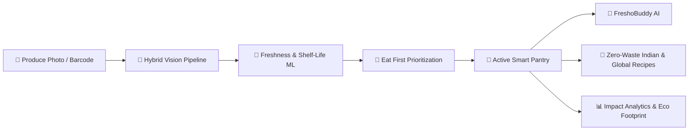

# FoodFresh AI 🌱
### *Know Your Food. Save Your Food. Waste Less.*

<div align="center">


[](https://www.python.org/)
[](https://fastapi.tiangolo.com/)
[](https://react.dev/)
[](https://vitejs.dev/)
[](https://tailwindcss.com/)
[](https://groq.com/)
[](https://github.com/anushka326/FoodFreshAI/releases/tag/v1.0.0-data)
[](LICENSE)

**FoodFresh AI** transforms kitchen sustainability into an interactive, gamified journey. By fusing **cutting-edge Computer Vision (GroundingDINO + SigLIP-2 + Fine-Tuned ResNet-18)**, **Machine Learning Shelf-Life Regression**, and **FreshoBuddy conversational culinary intelligence**, FoodFresh AI empowers households to eliminate food waste, conquer expiration countdowns, and turn produce into culinary triumphs.

[🚀 Explore Live Demo](#-quickstart-guide) • [🎮 Gamification & Companions](#-gamified-kitchen-experience) • [🧠 AI Architecture](#-machine-learning--vision-pipeline) • [📦 Dataset Setup](#-dataset-download-and-setup) • [🧪 Testing](#-testing--verification)

</div>

---

## 🎮 Gamified Kitchen Experience

FoodFresh AI turns zero-waste living into an engaging, score-driven kitchen RPG where every rescued food item levels up your sustainability stats.

```
+---------------------------------------------------------------------------------------+
|  🌿 KITCHEN PANTRY ECOLOGY INDEX: 94%                                🏆 LEVEL 7 CHEF   |
|  [████████████████████████████████████████████████████████░░░░]       1,420 / 2,000 XP |
+---------------------------------------------------------------------------------------+
|  🍽️ 8 Items Tracked     |  🚨 2 Eat-First Urgent    |  💧 1,278 L Water Saved         |
|  🥬 7 Rescued in Time   |  🎉 89% Stewardship Rate  |  💨 1.08 kg CO₂e Diverted       |
+---------------------------------------------------------------------------------------+
```

### 1. 🏅 3-Tier "Eat First" Urgency Quests
The system monitors produce age and dynamically issues real-time kitchen quests:
- 🔴 **Tier 1 — Critical Rescue (0–2 Days Left)**: Immediate priority! Ingredients close to their quality limit receive red alerts and instant recipe matches.
- 🟡 **Tier 2 — Prep Squad (3–5 Days Left)**: Moderate priority. Proactively suggested for weekday dinners and meal planning.
- 🟢 **Tier 3 — Fresh & Crisp (6+ Days Left)**: Safe and stable. Long-term storage optimization applied.

### 2. 🎭 36-Companion Kitchen Avatar Matrix
Personalize your chef identity! Choose from **36 original vector illustrated companions** across 6 distinct culinary and eco guilds:

| Guild | Icon | Representative Characters | Kitchen Specialty |
|---|:---:|---|---|
| **Fruit Buddies** | 🍎 | Pip the Apple, Bella Banana, Ruby Strawberry, Sunny Alphonso, Ollie Orange, Gaby Grape | Crispness guardians & fruit basket masters |
| **Veggie Friends** | 🥦 | Benny Broccoli, Chloe Carrot, Tommy Tomato, Sammy Spinach, Pippa Bell Pepper, Percy Pea Pod | Crisper-drawer nutrition champions |
| **Nature Lovers** | 🌱 | Sunny Sunflower, Rosie Rose, Daisy Blossom, Ferny Frond, Lily Lotus, Honey Lavender | Botanical storage & seasonal harvest buffs |
| **Animal Pals** | 🦊 | Barnaby Bear, Cleo Cat, Dash Dog, Poppy Penguin, Toby Turtle, Barnaby Bunny | Pollinator appreciation & pantry foraging scouts |
| **Little Chefs** | 👨‍🍳 | Chef Leo, Baker Bella, Squeezy Sam, Stirry Stella, Whisk Walter, Baker Bonnie | Zero-waste culinary mastery & creative substitutions |
| **Eco Heroes** | ♻️ | Terra Sprout, Hydro Drop, Solar Sol, Breeze Zephyr, Composting Charlie, Recycle Riley | Composting champions & closed-loop living |

### 3. 🌍 Scientifically Grounded Impact Analytics
Say goodbye to arbitrary constants. FoodFresh AI calculates your environmental footprint using authenticated **Life Cycle Assessment (LCA)** coefficients adapted from the **UN Food and Agriculture Organization (FAO)** and **Poore & Nemecek (2018)**:
- ⚖️ **Avoided Landfill Mass**: Cumulative weight of ingredients consumed before spoilage.
- 💨 **Mitigated $\text{CO}_2\text{e}$ Footprint**: Item-specific greenhouse gas reduction based on agricultural emission profiles.
- 💧 **Virtual Water Conserved**: Embedded crop irrigation and blue/green water savings.
- 📊 **Stewardship Ratio**: Interactive visual doughnut gauge tracking produce saved versus discarded.

---

## 🌟 Key Features



### 👁️ AI Vision & Produce Freshness Detection
- Upload photos or use live mobile camera capture without filters.
- **Master Hybrid Vision Pipeline** identifies produce species, detects visible deterioration, calculates freshness confidence scores, and projects remaining shelf-life days.
- **Smart Temperature Calibration**: Prevents overconfidence on ambiguous lighting or dark skins.

### ⏳ Trained Shelf-Life Regressor + USDA Guardrails
- Powered by a machine-learning **GradientBoostingRegressor** trained on produce decay intervals.
- Grounded by the **USDA FoodKeeper Database** to ensure realistic minimum/maximum lifespans across both **Countertop** and **Refrigerated** storage conditions.

### 🤖 FreshoBuddy AI (Groq & Qwen 2.5/3.8)
Your lively AI sous-chef and culinary companion:
- 🔄 **Pantry Mode ON**: Contextually grounded in your live pantry items. Ask *"What foods do I currently have?"* or *"What should I cook first?"* to receive tailored advice.
- 🌐 **Pantry Mode OFF (Global Mode)**: Open culinary encyclopedia answering general storage science, food preservation, and cooking queries.
- 🎯 **Advanced NLP Intent Engine**: Automatically identifies ownership queries, recipe searches, storage inquiries, and urgent ingredient triage.

### 🍛 Authentic Indian & Zero-Waste Global Recipe Engine
- Custom-tailored to minimize food waste by turning expiring pantry items into gourmet meals.
- Expansive catalogue of **authentic Indian recipes** (Dals, Sabzis, Curries, Biryanis, Street Snacks, Chutneys) and international cuisines.
- Includes YouTube cooking video links, ingredient checklists, prep times, and step-by-step instructions.

### 📦 Packaged Foods Scanner & Nutrition OCR
- Seamless barcode lookups backed by OpenFoodFacts.
- On-device optical character recognition to extract shelf-life dates, ingredients, and nutrition facts from packaging labels.

### 🔔 Slide-Over Expiry Alerts & Notification Drawer
- High-visibility slide-over drawer notifying you of expiring items without interrupting your active workflow.
- Direct links to analyze or cook with alert items.

### 🔐 Hardened Authentication & SQLite Architecture
- Multi-user isolation with non-destructive schema migrations.
- Supports email, full name, and lowercase username login aliases.
- Secure password hashing with legacy hash backward-compatibility.

---

## 🧠 Machine Learning & Vision Pipeline

FoodFresh AI deploys a layered hybrid intelligence stack:

```
+-----------------------------------------------------------------------------------------+
|                                MASTER HYBRID VISION PIPELINE                             |
+-----------------------------------------------------------------------------------------+
|  [Stage 1] Object Detection     | IDEA-Research/grounding-dino-base                     |
|                                 | Extracts bounding boxes & isolates food regions       |
+---------------------------------+-------------------------------------------------------+
|  [Stage 2] Semantic Recognition | google/siglip2-base-patch16-224                       |
|                                 | Zero-shot multi-modal feature vector extraction       |
+---------------------------------+-------------------------------------------------------+
|  [Stage 3] Domain Specialist    | AgriFreshNET Fine-Tuned ResNet-18 (V2)                |
|                                 | Classifies Freshness: Fresh, Semi-Fresh, Rotten       |
+---------------------------------+-------------------------------------------------------+
|  [Stage 4] Shelf-Life Regressor | GradientBoostingRegressor + USDA FoodKeeper Engine     |
|                                 | Estimates exact days remaining given kitchen storage  |
+---------------------------------+-------------------------------------------------------+
|  [Stage 5] Priority Engine      | Deterministic 3-Tier Eat First Multi-Factor Ranking   |
+-----------------------------------------------------------------------------------------+
```

---

## 📁 Repository Structure

```text
FoodFreshAI/
├── backend/                              # FastAPI REST API Backend
│   ├── app/
│   │   ├── database/chat_db.py           # SQLite database engine & schema migration
│   │   ├── deps/                         # JWT authentication & dependencies
│   │   ├── routes/                       # API routes (auth, food-recognition, pantry, analytics)
│   │   ├── schemas/                      # Pydantic request/response schemas
│   │   └── services/                     # Intent triage, analytics, Groq client
│   └── requirements.txt                  # Python dependencies
├── frontend/                             # React 19 + Vite 6 Application
│   ├── src/
│   │   ├── assets/avatars/               # 36-avatar SVG vector catalog
│   │   ├── assets/mascot/                # Official FreshoBuddy vector brand assets
│   │   ├── components/                   # Reusable UI components, widgets, modals
│   │   ├── pages/                        # Dashboard, Analyze, Pantry, Analytics, History
│   │   └── services/                     # Frontend API clients
│   ├── package.json                      # Node.js dependencies
│   └── vite.config.js                    # Vite bundler configuration
├── ml/                                   # Machine Learning Core
│   ├── hybrid_vision/                    # GroundingDINO, SigLIP-2 & ResNet fusion
│   ├── freshness/                        # AgriFreshNET ResNet-18 fine-tuning
│   └── shelf_life/                       # Shelf-life ML regressor & feature encoders
├── data/                                 # Datasets & Manifests (See Dataset Setup)
│   ├── raw/Synthetic data/               # 41,280-row synthetic shelf-life CSV & schema
│   ├── raw/foodkeeper/                   # USDA FoodKeeper official JSON
│   ├── processed/                        # 35 train/val/test split manifests & mappings
│   ├── real_world_eval/                  # Curated consumer smartphone evaluation photos
│   └── real_world_food/                  # Domain-adaptation category structures
├── models/                               # Pretrained & trained model weights (.joblib, .pth)
├── reports/                              # Dataset inspection & benchmark verification reports
├── scripts/                              # Automation & verification scripts
│   ├── download_datasets.py              # Automated 1.16 GB dataset downloader & extractor
│   └── validate_all_datasets.py          # 5-stage comprehensive dataset validation
└── README.md
```

---

## 📦 Dataset Download and Setup

FoodFresh AI combines laboratory produce datasets, agricultural real-world images, USDA food-safety benchmarks, and synthetic regression data.

### 1. Datasets Committed Directly to the Repository
The following supporting datasets are included directly in the Git repository:
- **FoodFreshAI Synthetic Dataset** (`data/raw/Synthetic data/`): 41,280 annotated entries across 43 classes covering produce, bakery, and environmental condition variations.
- **USDA FoodKeeper Database** (`data/raw/foodkeeper/FoodKeeper.json`): Official USDA reference shelf-life intervals.
- **Processed Split Manifests** (`data/processed/`): 35 train/val/test split CSV manifests and label mapping JSONs for AgriFreshNET and Fruits-360.
- **Real-World Test Images** (`data/real_world_eval/` & `data/real_world_food/`): Consumer evaluation images for testing domain adaptation.

### 2. Complete 1.16 GB Image Dataset (GitHub Releases)
The complete image dataset consists of **approximately 199,560 images** across **AgriFreshNET** (14,160 produce images with freshness stages) and **Fruits-360** (~184,840 high-resolution images).

Because committing 200,000 raw image files directly to Git exceeds GitHub's 100 MiB limit and bloats repository clone sizes, the full archive is published as an official GitHub Release asset:

- **Release Page**: [FoodFreshAI Complete Dataset v1.0.0 (Tag: v1.0.0-data)](https://github.com/anushka326/FoodFreshAI/releases/tag/v1.0.0-data)
- **Direct Download URL**: [https://github.com/anushka326/FoodFreshAI/releases/download/v1.0.0-data/data.zip](https://github.com/anushka326/FoodFreshAI/releases/download/v1.0.0-data/data.zip)
- **Archive Size**: 1,218,547,758 bytes (1,162.10 MB / 1.13 GB)
- **SHA-256 Checksum**: `dffbb071227a40c20d140a6a60c38872947ed5ec8ce9b3158338474816a145b2`

### 3. Automated One-Command Setup
To download, verify, and extract the complete dataset archive automatically:

```bash
python scripts/download_datasets.py
```

The script features:
- Instant detection: skips downloading if the dataset is already present.
- Live progress indicator with download speed.
- Strict SHA-256 integrity validation.
- Safe extraction directly into `data/raw/`.

Verify dataset integrity at any time:
```bash
python scripts/validate_all_datasets.py
```

---

## 🚀 Quickstart Guide

### Prerequisites
- **Python**: 3.10 or higher
- **Node.js**: 18.x or higher with npm
- **Groq API Key**: (Free tier available at [console.groq.com](https://console.groq.com/))

### 1. Clone the Repository
```bash
git clone https://github.com/anushka326/FoodFreshAI.git
cd FoodFreshAI
```

### 2. Backend Setup
```bash
# Create and activate virtual environment
python -m venv .venv
.\.venv\Scripts\Activate.ps1   # Windows PowerShell
# source .venv/bin/activate    # Linux / macOS

# Install backend dependencies
pip install -r backend/requirements.txt

# Configure environment variables
# Copy .env.example to backend/.env and populate your GROQ_API_KEY
copy backend\.env.example backend\.env   # Windows
# cp backend/.env.example backend/.env    # Linux / macOS

# Launch FastAPI backend server
uvicorn backend.app.main:app --host 127.0.0.1 --port 8000 --reload
```
*Backend Swagger Docs will be available at [http://127.0.0.1:8000/docs](http://127.0.0.1:8000/docs)*

### 3. Frontend Setup
```bash
# In a separate terminal window
cd frontend

# Install Node modules
npm install

# Start Vite development server
npm run dev
```
*Open [http://localhost:3000](http://localhost:3000) in your browser to experience FoodFresh AI.*

---

## 🧪 Testing & Verification

FoodFresh AI includes comprehensive automated test suites covering ML regression, authentication, intent triage, and analytics:

```bash
# Run core test suite (ML shelf-life, countdowns, intents, user isolation)
pytest tests/test_food_form_regression.py tests/test_fresho_buddy_intents.py \
  tests/test_food_recognition.py tests/test_shelf_life_regression.py \
  tests/test_synthetic_dataset_integration.py tests/test_pantry_countdown.py \
  tests/test_auth_user_isolation.py

# Test food recognition API endpoints
python -m unittest tests/test_food_recognition_api.py

# Verify LCA sustainability impact calculations
python scripts/test_impact_analytics_comprehensive.py

# Test FreshoBuddy conversational context & pantry ownership queries
python scripts/test_fresho_buddy_history_intelligence.py

# Build frontend for production
npm --prefix frontend run build
```

---

## 🛠️ Technology Stack

| Domain | Technologies |
|---|---|
| **Frontend UI/UX** | React 19, Vite 6, Tailwind CSS 4, Material Symbols, Lucide Icons, Canvas API |
| **Backend & REST APIs** | FastAPI, Uvicorn, Python 3.12, Pydantic V2, SQLite3 with WAL mode |
| **Computer Vision & ML** | PyTorch, Hugging Face Transformers, GroundingDINO, SigLIP-2, ResNet-18 / ResNet-50 |
| **Shelf-Life ML** | Scikit-Learn GradientBoostingRegressor, Joblib, NumPy, Pandas |
| **Conversational AI** | Groq Cloud API, Qwen 2.5 / Qwen 3.8, Custom Rule-Based Intent Classifier |
| **Security & Persistence** | JWT Bearer Tokens, Passlib / BCrypt, PBKDF2 Legacy Support, Isolated Databases |
| **Data & Benchmarks** | AgriFreshNET, Fruits-360, USDA FoodKeeper, UN FAO LCA Benchmarks |

---

## 🤝 Contributing & Community

Contributions make the open-source food sustainability community thrive!
1. Fork the Project (`https://github.com/anushka326/FoodFreshAI`)
2. Create your Feature Branch (`git checkout -b feature/CoolPantryFeature`)
3. Commit your Changes (`git commit -m "feat: add zero-waste recipe generator"`)
4. Push to the Branch (`git push origin feature/CoolPantryFeature`)
5. Open a Pull Request

---

## 📄 License

Distributed under the **MIT License**. See `LICENSE` for details.

---

<div align="center">

🌱 **FoodFresh AI** — *Empowering kitchens worldwide to eliminate food waste, one delicious meal at a time.*

Made with 💚 by **Anushka Pise** & the FoodFresh AI Team.

</div>
